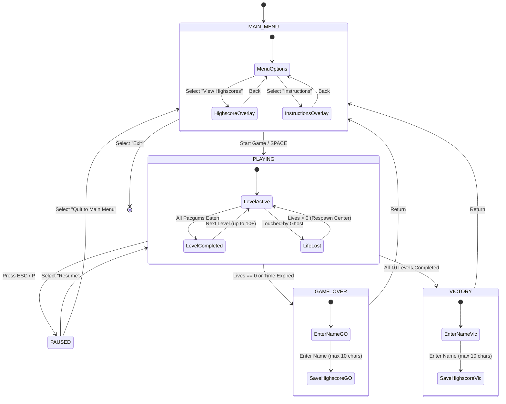
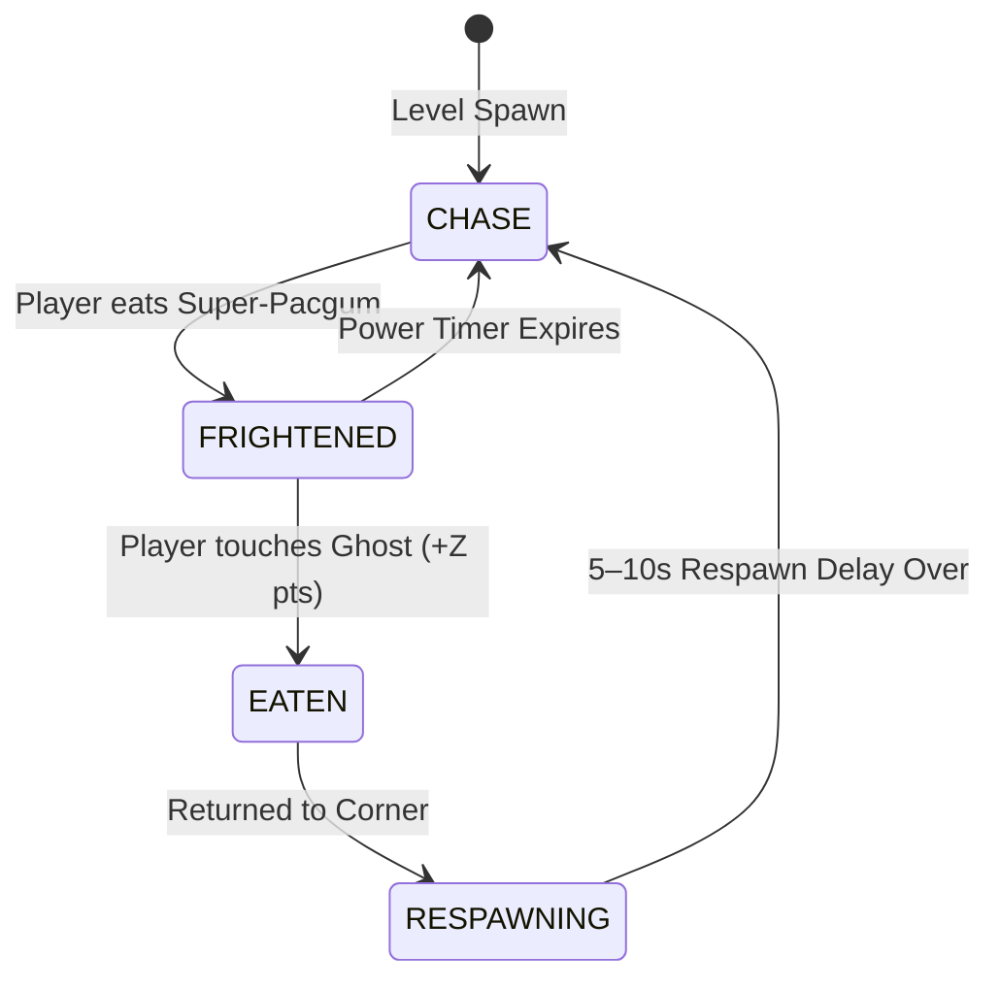
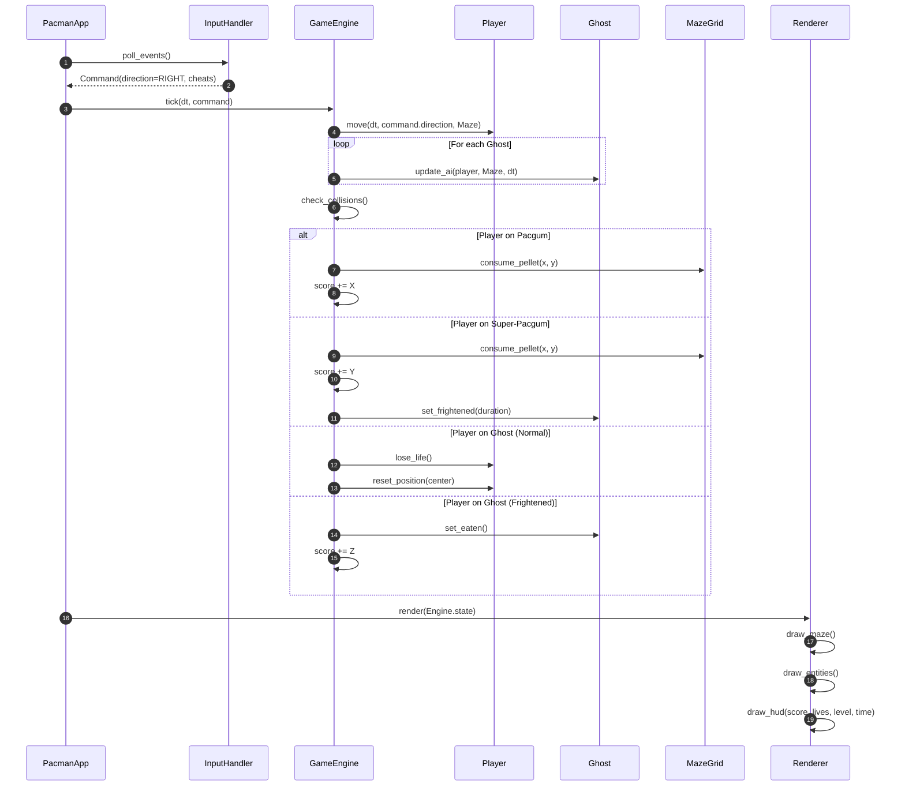

# Pac-Man: Architecture, Team Split & UML Design Specification

*Comprehensive project roadmap, two-member task distribution, and software architecture blueprint for the 42 Pac-Man project.*

---

## 1. Project Standards & Environment

- **Language**: Python 3.10+
- **Coding Standards**: `flake8` compliance, PEP 257 docstrings (Google/NumPy style)
- **Static Typing**: `mypy` strict type annotations for all functions, parameters, and returns
- **Error Handling**: Graceful exception management; clamp invalid configurations, ignore unknown keys, and **never output raw Python tracebacks**
- **External Dependencies**:
  - `mazegenerator` wheel (`mazegenerator-00001-py3-none-any.whl`) used as-is (`PERFECT = False`)
  - Graphical library (e.g., `pygame`)
  - Packaging with `PyInstaller` for platform release (Itch.io)

---

## 2. Team Work Breakdown (2 Members)

The architecture follows a decoupled **Model-View-Controller (MVC)** design to allow both members to develop in parallel without blocking each other or causing git conflicts.

```
┌─────────────────────────────────────────────────────────────┐
│                         pac-man.py                          │
│               (Entry Point & App Controller)                │
└───────────────┬─────────────────────────────┬───────────────┘
                │                             │
                ▼                             ▼
┌───────────────────────────────┐ ┌───────────────────────────┐
│   MEMBER 1: Engine & Model    │ │  MEMBER 2: View & Release │
├───────────────────────────────┤ ├───────────────────────────┤
│ • Configuration Parser        │ │ • Rendering Engine        │
│ • External Maze Adapter       │ │ • UI Menus & HUD          │
│ • Entity States & Grid Math   │ │ • Input & Event Handling  │
│ • Ghost AI Strategies         │ │ • Project Packaging       │
│ • Collision & Game Flow Rules │ │ • Itch.io Deployment     │
│ • Cheat Mode Logic            │ │ • Makefile Automation     │
│ • Highscore Persistence (JSON)│ │ • Testing & Asset Pipeline│
└───────────────────────────────┘ └───────────────────────────┘
```

### Member 1: Game Engine, Logic & Data Persistence (Model)
- **Config & Error Handling (`src/config.py`)**:
  - Parse JSON with comments (`#` comment lines).
  - Support global settings and optional `levels` array defining per-level width, height, and time limits.
  - Clamp invalid/missing values to safe defaults, ignore unknown keys, prevent crashes.
- **Maze Generator Adapter (`src/maze_adapter.py`)**:
  - Integrate `mazegenerator.MazeGenerator` (`size=(W, H)`, `perfect=False`, entry/exit).
  - Level 1: fixed seed (e.g. 42). Subsequent levels: random seed.
  - Spawn placements: Player in center, 4 ghosts in 4 corners, 4 super-pacgums in 4 corners, normal pacgums throughout corridors.
- **Core Entities & Physics (`src/entities/`, `src/engine.py`)**:
  - Grid movement, wall-corridor boundary collision checks.
  - Player lives (starts with 3), death, respawn in center, game over.
  - Pacgum consumption (+X pts), Super-pacgum consumption (+Y pts, activates frightened state).
  - Eating edible ghosts (+Z pts).
- **Ghost AI Strategies (`src/ghost_ai.py`)**:
  - Autonomous corridor movement.
  - Chase behaviors (direct target, ambush, patrol).
  - Frightened/fleeing mode on power pellet.
  - Eaten state and corner respawn timer (5–10s).
- **Progression & Cheats (`src/cheats.py`)**:
  - 10+ levels progression, level time limit countdown (`level_max_time`).
  - Cheat toggles: Invincibility, Level Skip, Freeze Ghosts, Extra Lives, Speed Multiplier.
- **Highscores Persistence (`src/highscore.py`)**:
  - Load/save Top 10 highscores from/to JSON as a `{player_name: score}` dictionary (personal best system, no timestamp needed).
  - Name validation: max 10 characters, alphanumeric and spaces only.
  - Non-negative integer score tracking, safe corrupt file handling.

---

### Member 2: Graphics, User Interface, Packaging & Deployment (View & Delivery)
- **Graphical Engine & Sprites (`src/ui/renderer.py`)**:
  - Window setup, dynamic scaling for maze sizes, delta time (`dt`) game clock.
  - Wall rendering, corridor rendering, animated pellet pulsation.
  - Pac-Man chomp animation (4 directions).
  - Ghost directional sprites, flashing frightened sprites, eyes-only eaten state.
- **Screens & UI State Machine (`src/ui/screens/`)**:
  - **Main Menu**: Start Game, View Highscores (Top 10 list), Instructions, Exit.
  - **In-Game HUD**: Visible during play: Score, Lives (icons), Level, Remaining Time.
  - **Pause Screen**: Overlay with Resume and Quit to Menu options.
  - **Game Over & Victory Screens**: Final score, message, interactive player name input field (validating 10 chars max).
- **Input & Events (`src/ui/input_handler.py`)**:
  - Support Arrow keys and WASD.
  - Hotkeys for evaluation cheat modes.
- **Makefile Automation (`Makefile`)**:
  - Targets: `install`, `run`, `debug`, `clean`, `lint`, `lint-strict`.
- **Packaging & Deployment (`packaging/`)**:
  - Build script / PyInstaller spec at repository root.
  - Self-contained executable test build.
  - Deployment setup for Itch.io (unlisted/private link).

---

### Shared Responsibilities
- **Project Management Folder (`project_management/`)**:
  - Timeline/Gantt/Kanban, actual progress vs timeline, risk analysis, decision log, acceptance test matrix.
- **Root `README.md`**:
  - Strictly follow Chapter IX required format (italicized first line with student logins, all required sections in English).

---

## 3. UML Class Diagram

```mermaid
classDiagram
    direction TB

    %% Application Entry & Orchestration
    class PacmanApp {
        -Config config
        -GameStateManager state_manager
        -Renderer renderer
        -InputHandler input_handler
        -bool is_running
        +run() void
        +quit() void
    }

    %% Configuration & Persistence (Member 1)
    class Config {
        +int width
        +int height
        +int lives
        +int pacgum
        +int points_per_pacgum
        +int points_per_super_pacgum
        +int points_per_ghost
        +int seed
        +int level_max_time
        +str highscore_filename
        +list~LevelConfig~ levels
        +from_file(path: str)$ Config
        +get_level_config(level_index: int) LevelConfig
        -_strip_comments(raw: str)$ str
        -_clamp_defaults(data: dict)$ dict
    }

    class LevelConfig {
        +int width
        +int height
        +int pacgum
        +int level_max_time
    }

    class HighscoreManager {
        -str filepath
        -dict~str,int~ scores
        +load() dict~str,int~
        +save(name: str, score: int) bool
        +is_high_score(score: int) bool
        +get_top_scores(limit: int) list~tuple~str,int~~
        -_sanitize_name(name: str) str
    }

    %% Maze Integration (Member 1)
    class MazeAdapter {
        -MazeGenerator external_generator
        -int width
        -int height
        +generate_level(level_index: int, seed: int) MazeGrid
        -_extract_corridors(bitmask_maze: list) list
    }

    class MazeGrid {
        +int width
        +int height
        +list~list~TileType~~ grid
        +tuple~int,int~ player_spawn
        +list~tuple~int,int~~ ghost_spawns
        +list~tuple~int,int~~ super_pacgum_positions
        +get_tile(x: int, y: int) TileType
        +is_wall(x: int, y: int) bool
        +consume_pellet(x: int, y: int) TileType
        +remaining_pellets() int
    }

    class TileType {
        <<enumeration>>
        EMPTY
        WALL
        PACGUM
        SUPER_PACGUM
    }

    %% Game Engine (Member 1)
    class GameEngine {
        -Config config
        -MazeGrid current_maze
        -Player player
        -list~Ghost~ ghosts
        -CheatManager cheats
        -int score
        -int current_level
        -float time_remaining
        -float frightened_timer
        +tick(dt: float) void
        +load_level(level_num: int) void
        +check_collisions() void
        +on_player_eats_pellet(x: int, y: int) void
        +on_player_ghost_collision(ghost: Ghost) void
        +is_level_completed() bool
        +is_game_over() bool
        +is_game_won() bool
    }

    class CheatManager {
        +bool god_mode
        +bool freeze_ghosts
        +float speed_multiplier
        +toggle_god_mode() void
        +toggle_freeze_ghosts() void
        +skip_level(engine: GameEngine) void
        +add_life(player: Player) void
    }

    %% Entity Hierarchy (Member 1)
    class Entity {
        <<abstract>>
        +float x
        +float y
        +float speed
        +Direction direction
        +Direction next_direction
        +move(dt: float, maze: MazeGrid) void
        +can_move(dir: Direction, maze: MazeGrid) bool
        +get_grid_position() tuple~int,int~
    }

    class Player {
        +int lives
        +float invulnerability_timer
        +reset_position(spawn: tuple~int,int~) void
        +lose_life() void
        +is_alive() bool
    }

    class Ghost {
        +GhostType ghost_type
        +GhostState state
        +tuple~int,int~ corner_home
        +float respawn_timer
        -GhostAIStrategy ai_strategy
        +update_ai(player: Player, maze: MazeGrid, dt: float) void
        +set_frightened(duration: float) void
        +respawn() void
    }

    class Direction {
        <<enumeration>>
        NONE
        UP
        DOWN
        LEFT
        RIGHT
    }

    class GhostState {
        <<enumeration>>
        CHASE
        FRIGHTENED
        EATEN
        IN_PEN
    }

    class GhostType {
        <<enumeration>>
        BLINKY
        PINKY
        INKY
        CLYDE
    }

    %% Ghost AI Strategy Pattern
    class GhostAIStrategy {
        <<interface>>
        +compute_next_move(ghost: Ghost, player: Player, maze: MazeGrid) Direction
    }

    class BlinkyChaseStrategy {
        +compute_next_move(ghost: Ghost, player: Player, maze: MazeGrid) Direction
    }
    class PinkyAmbushStrategy {
        +compute_next_move(ghost: Ghost, player: Player, maze: MazeGrid) Direction
    }
    class FrightenedFleeStrategy {
        +compute_next_move(ghost: Ghost, player: Player, maze: MazeGrid) Direction
    }
    class EatenReturnStrategy {
        +compute_next_move(ghost: Ghost, player: Player, maze: MazeGrid) Direction
    }

    %% UI & Views (Member 2)
    class Renderer {
        -Surface screen
        -dict sprites
        +render_maze(maze: MazeGrid) void
        +render_entities(player: Player, ghosts: list~Ghost~) void
        +render_hud(score: int, lives: int, level: int, time_left: float) void
        +render_menu(menu: Screen) void
    }

    class InputHandler {
        +handle_events() InputCommand
        +get_text_input() str
    }

    class GameStateManager {
        -Screen active_screen
        -dict~str,Screen~ screens
        +change_state(new_state: str) void
        +update(dt: float) void
        +draw(renderer: Renderer) void
    }

    class Screen {
        <<abstract>>
        +handle_input(command: InputCommand) void
        +update(dt: float) void
        +render(renderer: Renderer) void
    }

    class MainMenuScreen {
        -int selected_index
    }
    class PlayScreen {
        -GameEngine engine
    }
    class PauseScreen {
        -int selected_index
    }
    class GameOverScreen {
        -int final_score
        -str input_name
    }
    class VictoryScreen {
        -int final_score
        -str input_name
    }

    %% Relationships
    PacmanApp --> Config : loads
    PacmanApp --> GameStateManager : delegates flow
    PacmanApp --> Renderer : renders frames
    PacmanApp --> InputHandler : polls input

    GameStateManager --> Screen : manages active
    Screen <|-- MainMenuScreen
    Screen <|-- PlayScreen
    Screen <|-- PauseScreen
    Screen <|-- GameOverScreen
    Screen <|-- VictoryScreen

    PlayScreen --> GameEngine : controls
    PlayScreen --> HighscoreManager : submits scores
    GameOverScreen --> HighscoreManager : saves score
    VictoryScreen --> HighscoreManager : saves score
    MainMenuScreen --> HighscoreManager : reads top 10

    GameEngine --> MazeGrid : contains
    GameEngine --> Player : contains
    GameEngine --> Ghost : contains
    GameEngine --> CheatManager : checks
    MazeAdapter --> MazeGrid : constructs
    Config *-- LevelConfig : contains

    Entity <|-- Player
    Entity <|-- Ghost
    Ghost --> GhostAIStrategy : delegates AI
    GhostAIStrategy <|.. BlinkyChaseStrategy
    GhostAIStrategy <|.. PinkyAmbushStrategy
    GhostAIStrategy <|.. FrightenedFleeStrategy
    GhostAIStrategy <|.. EatenReturnStrategy
```



---

### Detailed Class Descriptions

The classes in the diagram are categorized into architectural modules. Each class description details its purpose, key attributes, methods, assigned developer, and mapping to subject requirements.

#### A. Core Orchestration & Lifecycle

##### `PacmanApp`
- **Assigned Developer**: Integration (Member 1 & Member 2)
- **Role & Purpose**: Top-level application coordinator instantiated by `pac-man.py`. Initializes subsystems (`Config`, `GameStateManager`, `Renderer`, `InputHandler`), manages the main execution loop, computes delta time (`dt`) per frame, and ensures clean shutdown without resource leaks.
- **Key Attributes**:
  - `config: Config`: The active configuration settings.
  - `state_manager: GameStateManager`: Manages active screen/state transitions.
  - `renderer: Renderer`: Presentation layer responsible for all drawing operations.
  - `input_handler: InputHandler`: Hardware event listener.
  - `is_running: bool`: Main loop control flag.
- **Key Methods**:
  - `run() -> None`: Starts the game loop, updates current state, and invokes renderer.
  - `quit() -> None`: Gracefully releases window surfaces and cleans up system resources.
- **Subject Requirement**: Chapter V.1 (`python3 pac-man.py config.json` entry point) and Chapter III.1 (resource management and leak prevention).

---

#### B. Configuration & Persistence (Member 1)

##### `Config` & `LevelConfig`
- **Assigned Developer**: Member 1
- **Role & Purpose**: Loads, strips comments, validates, and stores configuration settings from the input JSON file. Supports global baseline parameters as well as an optional `levels` array allowing distinct dimensions (`width`, `height`), target pellets (`pacgum`), and time limits (`level_max_time`) per level.
- **Key Attributes (`Config`)**:
  - `width: int`, `height: int`: Default dimensions of the maze grid.
  - `lives: int`: Initial player lives (default 3).
  - `pacgum: int`: Default target pacgum count.
  - `points_per_pacgum: int`, `points_per_super_pacgum: int`, `points_per_ghost: int`: Scoring values (+X, +Y, +Z).
  - `seed: int`: Fixed generator seed for Level 1 (e.g., 42).
  - `level_max_time: int`: Default time limit per level in seconds (e.g., 90s).
  - `highscore_filename: str`: Target file path for persistent scores.
  - `levels: list[LevelConfig]`: Optional array of per-level configurations.
- **Key Attributes (`LevelConfig`)**:
  - `width: int`, `height: int`: Dimensions specific to this level.
  - `pacgum: int`: Target pacgums for this level.
  - `level_max_time: int`: Time limit for this level.
- **Key Methods**:
  - `from_file(path: str) -> Config` *(classmethod)*: Reads the file, parses comments, and clamps values.
  - `get_level_config(level_index: int) -> LevelConfig`: Retrieves settings for level $N$, falling back to global defaults if level index exceeds the `levels` array.
  - `_strip_comments(raw: str) -> str` *(staticmethod)*: Removes `#`, `//`, and `/* */` comments before JSON parsing.
  - `_clamp_defaults(data: dict) -> dict` *(staticmethod)*: Replaces missing or invalid values with safe defaults and ignores unknown keys.
- **Subject Requirement**: Chapter V.2 & V.3 (JSON with comments, optional levels array of multiple levels with width/height, clamping to safe defaults, ignoring unknown keys, zero Python tracebacks).

##### `HighscoreManager`
- **Assigned Developer**: Member 1
- **Role & Purpose**: Handles persistent file I/O for top scores in `highscores.json`. Uses a flat dictionary structure (`{player_name: score}`) to record the personal best of each player without unnecessary timestamp overhead, and preserves the top 10 scores sorted descending.
- **Key Attributes**:
  - `filepath: str`: Path to `highscores.json`.
  - `scores: dict[str, int]`: Dictionary mapping player names directly to their personal best integer score.
- **Key Methods**:
  - `load() -> dict[str, int]`: Reads highscores from disk; safely handles missing or corrupted JSON by initializing an empty dictionary.
  - `save(name: str, score: int) -> bool`: Updates player's personal best (`max(existing, new)`), sorts descending by score, trims to Top 10, and writes cleanly to disk.
  - `is_high_score(score: int) -> bool`: Checks if a given score qualifies for the top 10 leaderboard.
  - `get_top_scores(limit: int = 10) -> list[tuple[str, int]]`: Returns sorted `[(name, score), ...]` pairs for UI menu rendering.
  - `_sanitize_name(name: str) -> str`: Enforces subject constraints (maximum 10 characters, alphanumeric and spaces only).
- **Subject Requirement**: Chapter V.5 (persistent highscore system, Top 10 retention, 10-char alphanumeric name limit, file error robustness, documented format in README).

---

#### C. Maze Integration & Board Model (Member 1)

##### `MazeAdapter`
- **Assigned Developer**: Member 1
- **Role & Purpose**: Implements the **Adapter Pattern** to wrap the external `mazegenerator` wheel without modifying its code. Translates external bitmask data into the game's internal `MazeGrid`.
- **Key Attributes**:
  - `external_generator: MazeGenerator`: Instance of the external package's class.
  - `width: int`, `height: int`: Grid size requested from config.
- **Key Methods**:
  - `generate_level(level_index: int, seed: int) -> MazeGrid`: Instantiates `MazeGenerator(size=(W, H), perfect=False, seed=seed)`, executes generation, and extracts tile positions.
  - `_extract_corridors(bitmask_maze: list[list[int]]) -> list`: Translates the 42 bitmask format (`1: North, 2: East, 4: South, 8: West, 15: 42-block`) into walkable corridors.
- **Subject Requirement**: Chapter V.4 & VI.1 (use external package as-is, `PERFECT=False`, Level 1 fixed seed, subsequent random seeds, handle generator failures cleanly).

##### `MazeGrid` & `TileType`
- **Assigned Developer**: Member 1
- **Role & Purpose**: Holds the 2D grid matrix of the board and manages spatial queries for entities and consumables.
- **Key Attributes**:
  - `grid: list[list[TileType]]`: 2D matrix of tile classifications.
  - `player_spawn: tuple[int, int]`: Center coordinate for player start and respawn.
  - `ghost_spawns: list[tuple[int, int]]`: 4 corner coordinates for ghost starting locations.
  - `super_pacgum_positions: list[tuple[int, int]]`: 4 corner coordinates for power pellets.
  - *`TileType` Enum values*: `EMPTY`, `WALL`, `PACGUM`, `SUPER_PACGUM`.
- **Key Methods**:
  - `get_tile(x: int, y: int) -> TileType`: Returns the tile at grid coordinates.
  - `is_wall(x: int, y: int) -> bool`: Checks whether a tile blocks entity movement.
  - `consume_pellet(x: int, y: int) -> TileType`: Removes and returns the pellet at `(x, y)`.
  - `remaining_pellets() -> int`: Returns remaining pacgum count to evaluate level completion.
- **Subject Requirement**: Chapter VI.1 & VI.4 (walls/corridors, pacgums in most corridors, 4 super-pacgums in corners, center player spawn, 4 corner ghost spawns).

---

#### D. Game Engine & Simulation (Member 1)

##### `GameEngine`
- **Assigned Developer**: Member 1
- **Role & Purpose**: The core model orchestrator. Advances game physics, decrements timers, executes collision checks, updates scores, and handles level transitions. Completely independent of graphical libraries.
- **Key Attributes**:
  - `config: Config`: Rules and scoring constants.
  - `current_maze: MazeGrid`: Active level layout.
  - `player: Player`: The player entity instance.
  - `ghosts: list[Ghost]`: Collection of the 4 active ghosts.
  - `cheats: CheatManager`: Active cheat flags.
  - `score: int`: Current accumulated score across levels.
  - `current_level: int`: Current level index (1 through 10+).
  - `time_remaining: float`: Countdown timer for the current level.
  - `frightened_timer: float`: Remaining duration for ghost edible mode.
- **Key Methods**:
  - `tick(dt: float) -> None`: Advances entities, updates AI, ticks timers, and processes collisions.
  - `load_level(level_num: int) -> None`: Loads new maze from `MazeAdapter`, resets entity coordinates, and resets level timer.
  - `check_collisions() -> None`: Tests player against pellets and ghosts.
  - `on_player_eats_pellet(x: int, y: int) -> None`: Awards +X or +Y score; triggers ghost frightened state if super-pacgum.
  - `on_player_ghost_collision(ghost: Ghost) -> None`: If edible -> eats ghost for +Z pts; if normal -> player loses life and respawns in center (unless god mode enabled).
  - `is_level_completed() -> bool`: Returns true if all pacgums in maze are consumed.
  - `is_game_over() -> bool`: Returns true if player lives reach 0 or time runs out.
  - `is_game_won() -> bool`: Returns true after clearing level 10.
- **Subject Requirement**: Chapter VI.2, VI.6, VI.7 (lives decrement, score calculation, 10 levels, timer per level, game win/loss).

##### `CheatManager`
- **Assigned Developer**: Member 1
- **Role & Purpose**: Manages evaluation-assist cheat toggles to facilitate grading and peer review.
- **Key Attributes**:
  - `god_mode: bool`: Prevents player life loss on ghost contact.
  - `freeze_ghosts: bool`: Halts all ghost movement and AI.
  - `speed_multiplier: float`: Accelerates player movement speed.
- **Key Methods**:
  - `toggle_god_mode() -> None`: Toggles player invincibility.
  - `toggle_freeze_ghosts() -> None`: Toggles ghost freeze.
  - `skip_level(engine: GameEngine) -> None`: Instantly completes current level and triggers next level.
  - `add_life(player: Player) -> None`: Grants an extra life.
- **Subject Requirement**: Chapter VI.5 (mandatory cheat mode: invincibility, level skip, ghost freeze, extra lives, increased speed).

---

#### E. Entity Hierarchy & Ghost AI (Member 1)

##### `Entity` *(Abstract Base Class)*
- **Assigned Developer**: Member 1
- **Role & Purpose**: Base class establishing common kinematic properties and corridor navigation for all actors.
- **Key Attributes**:
  - `x: float`, `y: float`: World / grid floating coordinates.
  - `speed: float`: Movement speed in units per second.
  - `direction: Direction`, `next_direction: Direction`: Current and buffered movement direction (`UP`, `DOWN`, `LEFT`, `RIGHT`, `NONE`).
- **Key Methods**:
  - `move(dt: float, maze: MazeGrid) -> None`: Updates `(x, y)` position along corridor paths.
  - `can_move(dir: Direction, maze: MazeGrid) -> bool`: Checks ahead to verify target tile is not a wall.
  - `get_grid_position() -> tuple[int, int]`: Returns discrete integer grid indices `(col, row)`.

##### `Player`
- **Assigned Developer**: Member 1
- **Role & Purpose**: Represents Pac-Man. Inherits from `Entity`.
- **Key Attributes**:
  - `lives: int`: Remaining player lives (starts at 3).
  - `invulnerability_timer: float`: Brief immunity window immediately following respawn.
- **Key Methods**:
  - `reset_position(spawn: tuple[int, int]) -> None`: Teleports player back to the maze center.
  - `lose_life() -> None`: Decrements life count.
  - `is_alive() -> bool`: Returns whether `lives > 0`.
- **Subject Requirement**: Chapter VI.2 (corridor movement, 4 directions, 3 lives, respawn in center, life loss on touch).

##### `Ghost`
- **Assigned Developer**: Member 1
- **Role & Purpose**: Represents an autonomous enemy ghost. Inherits from `Entity`.
- **Key Attributes**:
  - `ghost_type: GhostType`: Identity (`BLINKY`, `PINKY`, `INKY`, `CLYDE`).
  - `state: GhostState`: Operational mode (`CHASE`, `FRIGHTENED`, `EATEN`, `IN_PEN`).
  - `corner_home: tuple[int, int]`: Assigned corner coordinate.
  - `respawn_timer: float`: Countdown timer before an eaten ghost respawns.
  - `ai_strategy: GhostAIStrategy`: Pluggable AI pathfinding strategy.
- **Key Methods**:
  - `update_ai(player: Player, maze: MazeGrid, dt: float) -> None`: Delegates path computation to the active `GhostAIStrategy`.
  - `set_frightened(duration: float) -> None`: Switches state to `FRIGHTENED` and reverses movement.
  - `respawn() -> None`: Resets ghost back to corner spawn after 5–10s when eaten.
- **Subject Requirement**: Chapter VI.3 (4 ghosts, autonomous corridor movement, chasing player, fleeing when edible, corner respawn after 5–10 seconds).

##### `GhostAIStrategy` *(Interface)* & Concrete Strategies
- **Assigned Developer**: Member 1
- **Role & Purpose**: Implements the **Strategy Pattern** to separate AI pathfinding behaviors from the `Ghost` class, allowing distinct behaviors and easy unit testing with `pytest`.
- **Implementations**:
  - `BlinkyChaseStrategy`: Direct chase targeting player's exact current grid tile.
  - `PinkyAmbushStrategy`: Ambush targeting 4 tiles ahead of player's heading direction.
  - `FrightenedFleeStrategy`: Calculates moves away from the player or picks randomized open corridor turns.
  - `EatenReturnStrategy`: Shortest-path navigation back to corner spawn.
- **Subject Requirement**: Chapter VI.3 (customizable ghost chase behaviors and frightened fleeing).

---

#### F. Presentation, UI & Packaging (Member 2)

##### `Renderer`
- **Assigned Developer**: Member 2
- **Role & Purpose**: Low-level graphical rendering engine (built on `pygame` or `MLX`). Translates game model states into visual frames.
- **Key Attributes**:
  - `screen: Surface`: Main display surface window.
  - `sprites: dict`: Pre-rendered or loaded sprite textures (Pac-Man chomp frames, ghost colors, blinking ghosts, eyes, pacgums).
- **Key Methods**:
  - `render_maze(maze: MazeGrid) -> None`: Renders wall segments, corridors, and pellets.
  - `render_entities(player: Player, ghosts: list[Ghost]) -> None`: Draws animated player and ghosts at interpolated coordinates.
  - `render_hud(score: int, lives: int, level: int, time_left: float) -> None`: Draws score, life icons, level counter, and remaining time.
  - `render_menu(menu: Screen) -> None`: Draws UI screens, buttons, and text fields.
- **Subject Requirement**: Chapter IV (polished graphical UI) & Chapter VI.8 (in-game HUD visible during gameplay).

##### `InputHandler`
- **Assigned Developer**: Member 2
- **Role & Purpose**: Translates OS-level keyboard events into high-level game commands (`InputCommand`).
- **Key Methods**:
  - `handle_events() -> InputCommand`: Polls input queue for WASD/Arrow keys, Pause (ESC/P), and cheat keys.
  - `get_text_input() -> str`: Captures character-by-character string input for player name on Game Over / Victory screens.
- **Subject Requirement**: Chapter VI.2 (WASD and Arrow keys) & Chapter VI.5 (cheat hotkeys).

##### `GameStateManager`
- **Assigned Developer**: Member 2
- **Role & Purpose**: State machine governing active UI screens and game flow transitions.
- **Key Attributes**:
  - `active_screen: Screen`: Currently displayed screen instance.
  - `screens: dict[str, Screen]`: Registry of screen instances (`"MAIN_MENU"`, `"PLAY"`, `"PAUSE"`, `"GAME_OVER"`, `"VICTORY"`).
- **Key Methods**:
  - `change_state(new_state: str) -> None`: Switches the active screen.
  - `update(dt: float) -> None`: Dispatches update to the active screen.
  - `draw(renderer: Renderer) -> None`: Renders the active screen.
- **Subject Requirement**: Chapter IV (Game Loop state machine: Main Menu -> Start -> Win/Lose -> Highscore -> Main Menu).

##### `Screen` *(Abstract Base Class)* & Concrete Screens
- **Assigned Developer**: Member 2
- **Role & Purpose**: Base class for interactive screens. Provides uniform `handle_input`, `update`, and `render` lifecycle hooks.
- **Subclasses**:
  - `MainMenuScreen`: Start Game, View Highscores (Top 10 list), Instructions, Exit (Chapter VI.8).
  - `PlayScreen`: Wraps the `GameEngine`, forwards player input, and calls HUD/world rendering.
  - `PauseScreen`: Transparent overlay allowing Resume or Quit to Main Menu (Chapter VI.8).
  - `GameOverScreen`: Displays final score, game over message, and interactive text box for highscore name entry (Chapter VI.8).
  - `VictoryScreen`: Displays final score, congratulations on clearing level 10, and interactive text box for highscore name entry (Chapter VI.8).
- **Subject Requirement**: Chapter VI.8 (complete UI specification for all menus and overlays).

---

## 4. Game State Machine



---

## 5. Ghost AI State Machine



---

## 6. Frame Update Sequence (Game Loop)



---

## 7. Recommended Repository File Layout

```
pac-man/
├── pac-man.py                  # Main entry point (python3 pac-man.py config.json)
├── config.json                 # Sample config with # comments
├── highscores.json             # Persistent highscores storage
├── Makefile                    # install, run, debug, clean, lint, lint-strict
├── README.md                   # Chapter IX compliant documentation
├── ARCHITECTURE.md             # This architecture & UML specification
├── pyproject.toml / setup.cfg  # Packaging specifications
├── packaging/                  # PyInstaller spec and packaging scripts
├── project_management/         # Chapter VIII management deliverables
│   ├── timeline_gantt.md
│   ├── risk_analysis.md
│   ├── team_organization.md
│   └── acceptance_tests.md
├── src/
│   ├── __init__.py
│   ├── app.py                  # Main PacmanApp loop
│   ├── config.py               # JSON + comments parser & clamping defaults
│   ├── maze_adapter.py         # Adapter for mazegenerator-00001
│   ├── engine.py               # Core GameEngine & collision physics
│   ├── entities.py             # Entity, Player, Ghost classes
│   ├── ghost_ai.py             # Strategy pattern AI behaviors
│   ├── cheats.py               # CheatManager implementation
│   ├── highscore.py            # HighscoreManager JSON handler
│   └── ui/
│       ├── __init__.py
│       ├── renderer.py         # Pygame/MLX drawing engine
│       ├── input_handler.py    # Keyboard & text event listener
│       └── screens/            # MainMenu, Play, Pause, GameOver, Victory
└── tests/                      # Unit tests (pytest)
    ├── test_config.py
    ├── test_maze_adapter.py
    ├── test_highscore.py
    └── test_game_rules.py
```
