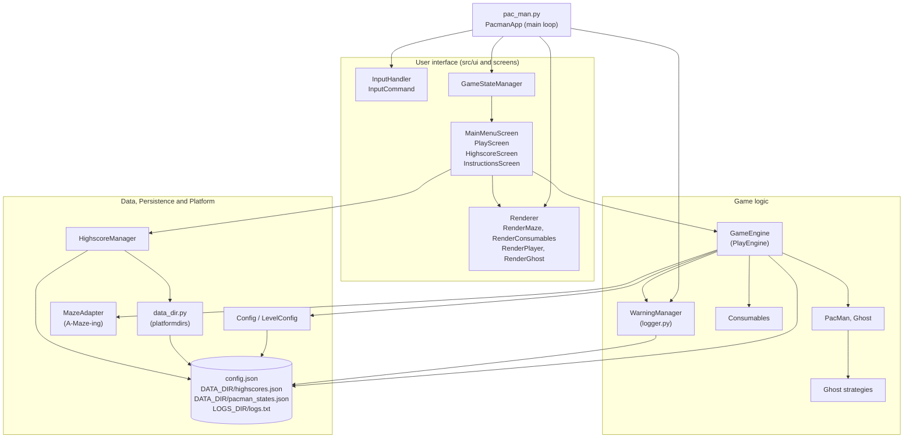
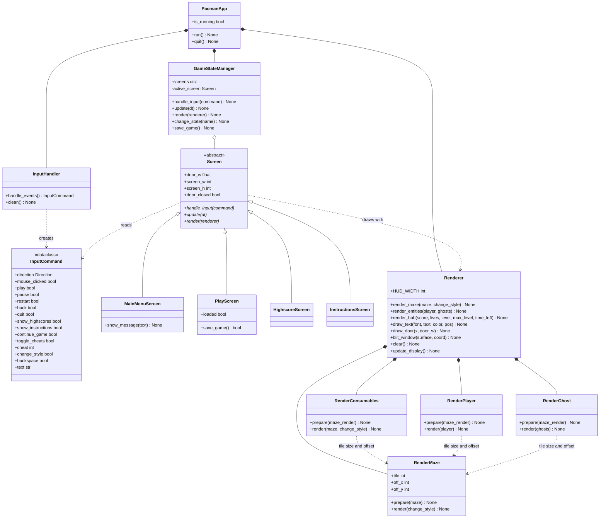
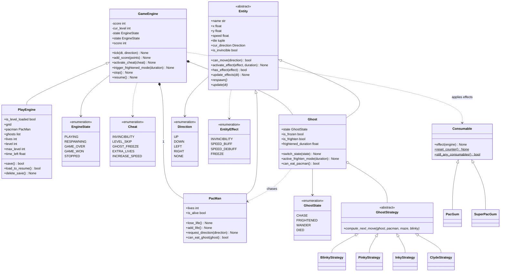
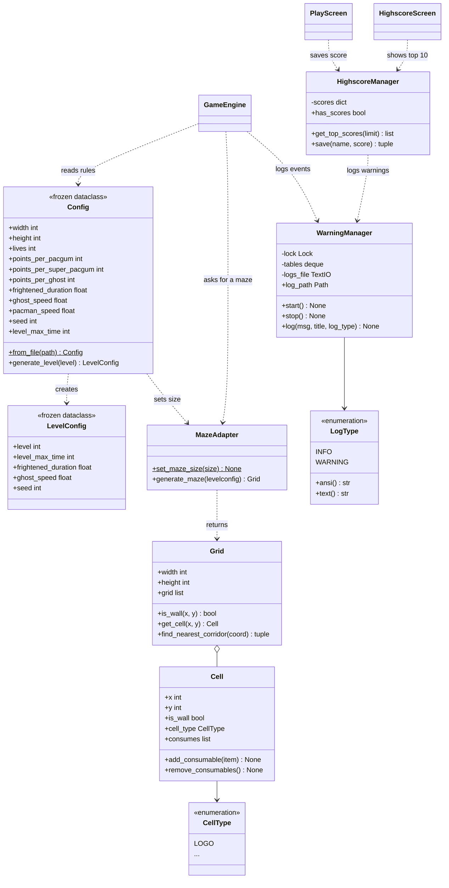
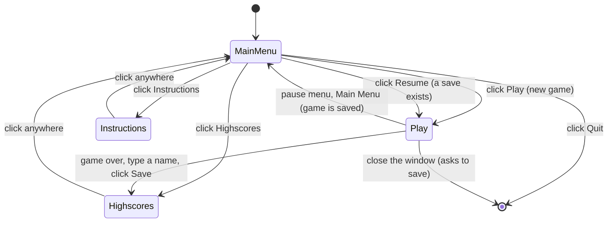
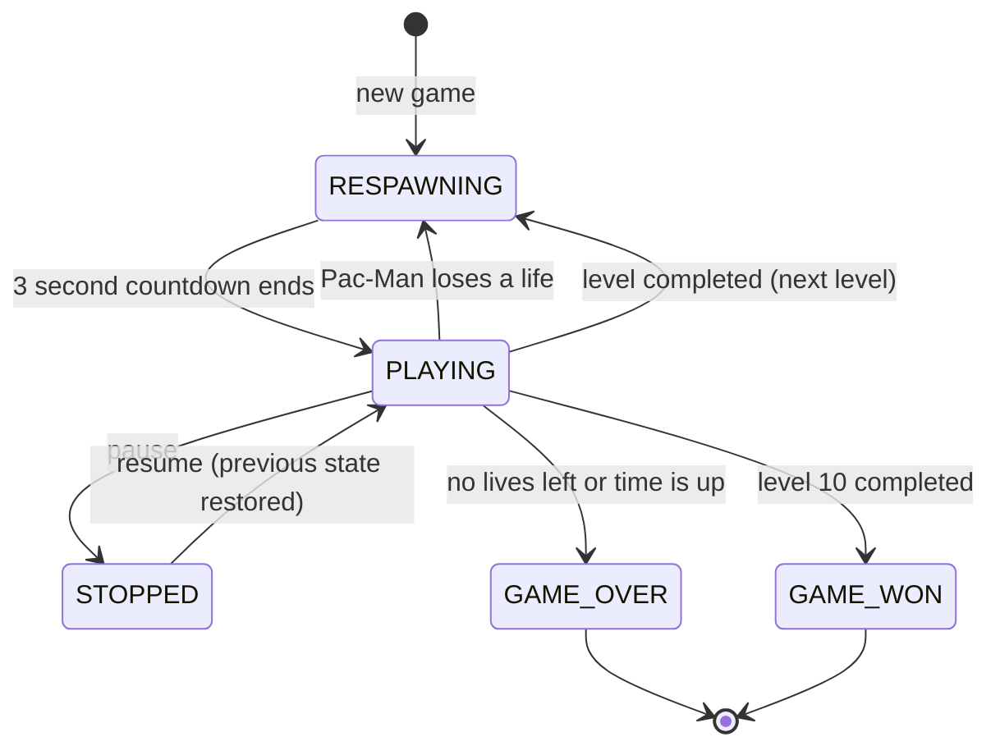
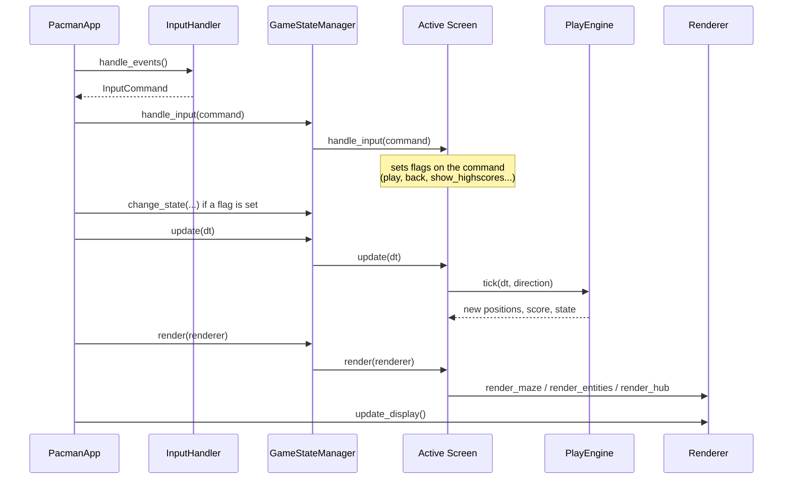
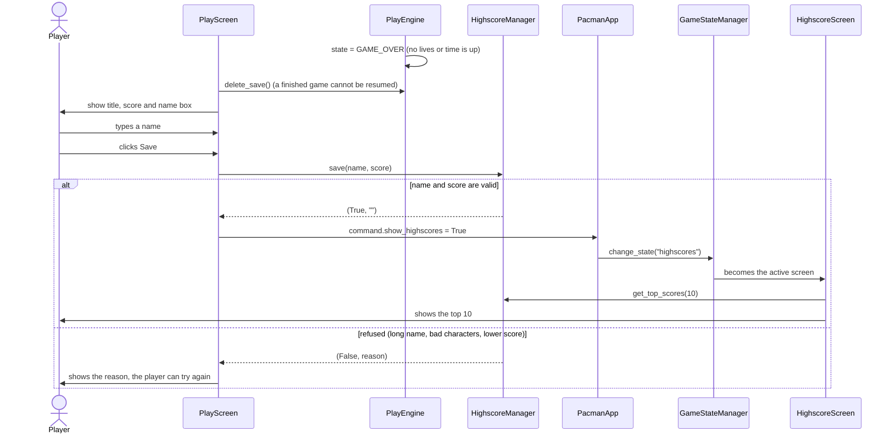

# UML Diagrams

All diagrams are written in [Mermaid](https://mermaid.js.org/). GitHub and GitLab draw them automatically when you open this file.

| # | Diagram | Shows |
| --- | --- | --- |
| 1 | Layers overview | The big blocks of the project and who uses whom |
| 2 | UI classes | Screens, input and renderers |
| 3 | Game logic classes | Engine, entities and ghost AI |
| 4 | Data classes | Config, highscores and maze |
| 5 | Screen navigation | How the player moves between screens |
| 6 | Engine states | The life cycle of a game |
| 7 | Sequence: one frame | What happens 60 times per second |
| 8 | Sequence: end of a game | From game over to the highscore table |

---

## 1. Layers overview

The game logic never imports pygame. The screens talk to the engine only through the public properties of `PlayEngine`.

---

## 2. UI classes

---

## 3. Game logic classes

---

## 4. Data classes

> `Grid` and `Cell` are the names used in this document for the maze grid and its cells. Use the real class names from `maze_adapter.py` if they are different.

---

## 5. Screen navigation

---

## 6. Engine states

---

## 7. Sequence: one frame of the game

This repeats 60 times per second in `PacmanApp.run`.

---

## 8. Sequence: end of a game

