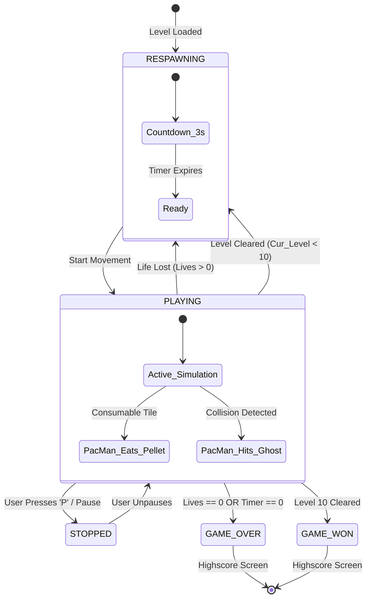
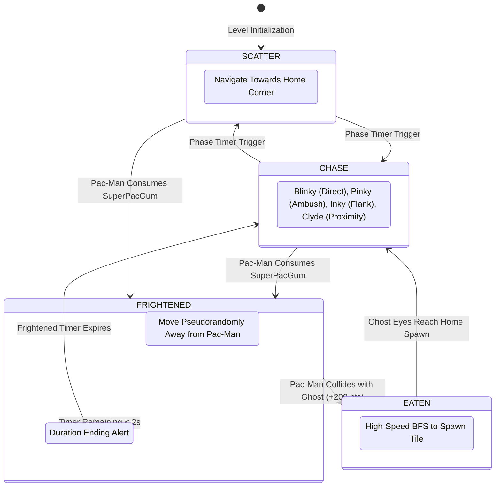
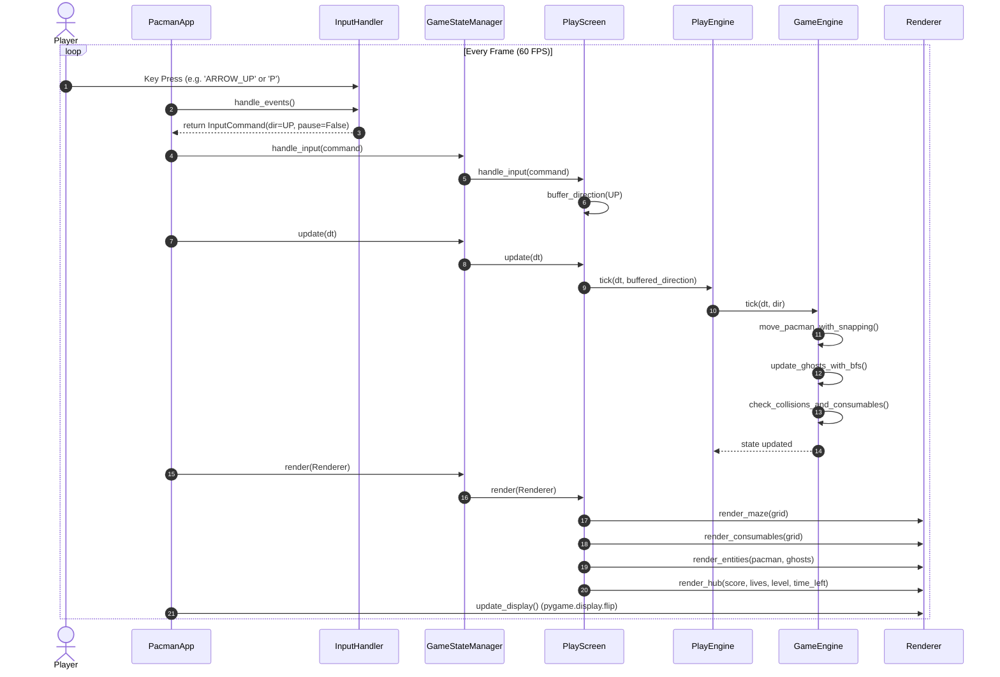

# System UML Diagrams & Software Architecture Specifications

*42 Network / 1337 Coding School — Pac-Man Project Management*

---

## 1. Architectural Boundary & Component Diagram

The following architecture diagram represents the decoupled Model-View-Controller (MVC) organization of the project, highlighting the distinct ownership boundaries between **`abchtaib` (UI & Rendering)** and **`yoelboud` (Logic & Engine)**.

```mermaid
flowchart TD
    subgraph UI_Presentation["VIEW & PRESENTATION LAYER (abchtaib)"]
        direction TB
        App["PacmanApp (Main Entry Point)"]
        IH["InputHandler (Pygame Event Queue)"]
        GSM["GameStateManager"]
        
        subgraph Screens["Screen Implementations"]
            MM["MainMenuScreen"]
            PS["PlayScreen"]
            HS["HighscoreScreen"]
            IS["InstructionsScreen"]
        end
        
        subgraph Renderers["Rendering Subsystem"]
            R["Renderer (Master Coordinator)"]
            RM["RenderMaze (8-Neighbor Autotiling)"]
            RP["RenderPlayer (Directional Mouth Animation)"]
            RG["RenderGhost (Colors, Frightened & Eyes)"]
            RC["RenderConsumables (Dots & Pulsing SuperDots)"]
        end
    end

    subgraph Domain_Model["DOMAIN LOGIC & ENGINE LAYER (yoelboud)"]
        direction TB
        PE["PlayEngine (Public Facade Interface)"]
        GE["GameEngine (Physics, Ticks & Collisions)"]
        
        subgraph Entities_Domain["Entities & Movement"]
            PM["PacMan (Lives, Invincibility, Speed)"]
            GH["Ghost (4 Instances, States, Target Tile)"]
            DIR["Direction (UP, DOWN, LEFT, RIGHT)"]
        end
        
        subgraph AI_Domain["Ghost AI Strategy Pattern"]
            GS["GhostStrategy (Abstract Base)"]
            Blinky["BlinkyStrategy (Direct Chase)"]
            Pinky["PinkyStrategy (4-Tile Ambush)"]
            Inky["InkyStrategy (Dual-Vector Flank)"]
            Clyde["ClydeStrategy (Proximity Retreat)"]
        end
        
        subgraph Maze_Domain["Procedural Maze & Config"]
            MA["MazeAdapter (A-Maze-ing Wheel Wrapper)"]
            MG["MazeGrid & Cell"]
            CFG["Config & LevelConfig (Lark Parser)"]
            HIGH["HighscoreManager (JSON Store)"]
        end
    end

    %% Cross-boundary communication
    App --> IH
    App --> GSM
    IH -->|"Emits InputCommand"| GSM
    GSM --> MM
    GSM --> PS
    GSM --> HS
    GSM --> IS
    
    PS -->|"Reads State Snapshots"| PE
    PE --> GE
    PS --> R
    R --> RM
    R --> RP
    R --> RG
    R --> RC
    
    GE --> PM
    GE --> GH
    GE --> MA
    MA --> MG
    GE --> CFG
    PS --> HIGH
    HS --> HIGH
    
    GH --> GS
    GS <|-- Blinky
    GS <|-- Pinky
    GS <|-- Inky
    GS <|-- Clyde
```

---

## 2. Core System UML Class Diagram

This comprehensive Class Diagram specifies the primary classes, fields, methods, and their relationships across the codebase.

```mermaid
classDiagram
    %% Entry Point & Screens
    class PacmanApp {
        -GameStateManager _game_state_manager
        -InputHandler _input_handler
        -Renderer _renderer
        -bool _is_running
        +run() void
        +quit() void
    }

    class Screen {
        <<abstract>>
        +handle_input(InputCommand command) void*
        +update(float dt) void*
        +render(Renderer renderer) void*
    }

    class MainMenuScreen {
        -dict _buttons
        -bool _door_closed
        +handle_input(InputCommand command) void
        +update(float dt) void
        +render(Renderer renderer) void
        +show_message(str text) void
    }

    class PlayScreen {
        -PlayEngine _engine
        -Renderer _renderer
        -HighscoreManager _highscore_manager
        -bool _is_paused
        -bool _cheat_mode
        +handle_input(InputCommand command) void
        +update(float dt) void
        +render(Renderer renderer) void
        +save_game() void
    }

    class HighscoreScreen {
        -HighscoreManager _manager
        +handle_input(InputCommand command) void
        +update(float dt) void
        +render(Renderer renderer) void
    }

    class InstructionsScreen {
        +handle_input(InputCommand command) void
        +update(float dt) void
        +render(Renderer renderer) void
    }

    Screen <|-- MainMenuScreen
    Screen <|-- PlayScreen
    Screen <|-- HighscoreScreen
    Screen <|-- InstructionsScreen
    PacmanApp --> Screen

    %% Input Handling
    class InputHandler {
        -InputCommand _command
        +handle_events() InputCommand
        +clean() void
    }

    class InputCommand {
        +Direction direction
        +bool click
        +tuple mouse_pos
        +bool pause
        +str text_typed
        +int cheat_key
        +bool save
        +bool play
    }

    InputHandler --> InputCommand
    Screen ..> InputCommand

    %% Renderers
    class Renderer {
        -Surface _window
        -RenderMaze _render_maze
        -RenderPlayer _render_player
        -RenderGhost _render_ghost
        -RenderConsumables _render_consumables
        +render_maze(MazeGrid grid) void
        +render_entities(PacMan pacman, list ghosts) void
        +render_hub(int score, int lives, int level, float time_left) void
        +update_display() void
        +clear() void
    }

    class RenderMaze {
        -Surface _wall_spritesheet
        -int _tile_size
        +prepare(int width, int height) void
        +render(Surface surface, MazeGrid grid) void
        -_get_mask(MazeGrid grid, int x, int y) int
    }

    class RenderPlayer {
        -Surface _spritesheet
        -float _anim_timer
        +prepare(int tile_size) void
        +render(Surface surface, PacMan pacman) void
    }

    class RenderGhost {
        -Surface _spritesheet
        +prepare(int tile_size) void
        +render(Surface surface, list ghosts) void
        -_pick_sprite(Ghost ghost) Surface
    }

    class RenderConsumables {
        -Surface _pellet_sprites
        +prepare(int tile_size) void
        +render(Surface surface, MazeGrid grid) void
    }

    Renderer *-- RenderMaze
    Renderer *-- RenderPlayer
    Renderer *-- RenderGhost
    Renderer *-- RenderConsumables
    PlayScreen --> Renderer

    %% Engine & Facade
    class PlayEngine {
        -GameEngine _engine
        +grid MazeGrid
        +pacman PacMan
        +ghosts list~Ghost~
        +lives int
        +level int
        +time_left float
        +save() void
        +load() bool
    }

    class GameEngine {
        -EngineState _state
        -MazeGrid _grid
        -PacMan _pacman
        -list~Ghost~ _ghosts
        -Config _config
        -int _cur_level
        -int _score
        -float _level_time
        +tick(float dt, Direction desired_dir) void
        +activate_cheat(Cheat cheat) void
        +trigger_frightened_mode() void
        +is_game_over() bool
        +is_game_won() bool
        +is_level_completed() bool
        +stop() void
        +resume() void
    }

    PlayScreen --> PlayEngine
    PlayEngine --> GameEngine

    %% Entities
    class Entity {
        <<abstract>>
        +float x
        +float y
        +float speed
        +Direction cur_direction
        +Direction next_direction
        +tuple tile
        +can_move(Direction dir, MazeGrid grid) bool
        +update(float dt, MazeGrid grid) void*
        +respawn() void
    }

    class PacMan {
        -int _lives
        -bool _is_invincible
        +lives int
        +is_alive bool
        +lose_life() void
        +add_life() void
        +toggle_invincibility() void
        +request_direction(Direction dir) void
        +update(float dt, MazeGrid grid) void
    }

    class Ghost {
        -GhostState _state
        -GhostStrategy _strategy
        -tuple _target_tile
        -float _frightened_timer
        +state GhostState
        +is_frightened bool
        +freeze() void
        +activate_frightened_mode(float duration) void
        +update(float dt, MazeGrid grid, PacMan pacman) void
    }

    Entity <|-- PacMan
    Entity <|-- Ghost
    GameEngine *-- PacMan
    GameEngine *-- Ghost

    %% Ghost AI Strategy Pattern
    class GhostStrategy {
        <<abstract>>
        +compute_next_move(Ghost ghost, MazeGrid grid, PacMan pacman) Direction*
        #_go_to(tuple start, tuple target, MazeGrid grid) Direction
    }

    class BlinkyStrategy {
        +compute_next_move(Ghost ghost, MazeGrid grid, PacMan pacman) Direction
    }

    class PinkyStrategy {
        +compute_next_move(Ghost ghost, MazeGrid grid, PacMan pacman) Direction
    }

    class InkyStrategy {
        +compute_next_move(Ghost ghost, MazeGrid grid, PacMan pacman) Direction
    }

    class ClydeStrategy {
        +compute_next_move(Ghost ghost, MazeGrid grid, PacMan pacman) Direction
    }

    GhostStrategy <|-- BlinkyStrategy
    GhostStrategy <|-- PinkyStrategy
    GhostStrategy <|-- InkyStrategy
    GhostStrategy <|-- ClydeStrategy
    Ghost *-- GhostStrategy

    %% Maze & Consumables
    class MazeAdapter {
        +set_maze_size(tuple size)$ void
        +generate_maze(LevelConfig config)$ MazeGrid
    }

    class MazeGrid {
        -dict _cells
        +is_wall(int x, int y) bool
        +find_nearest_corridor(int x, int y) tuple
        +get_cell(int x, int y) Cell
    }

    class Cell {
        +CellType cell_type
        +Consumable consumable
        +is_wall() bool
    }

    class Consumable {
        <<abstract>>
        +int points
        +apply_effect(GameEngine engine) void*
    }

    class PacGum {
        +apply_effect(GameEngine engine) void
    }

    class SuperPacGum {
        +apply_effect(GameEngine engine) void
    }

    MazeAdapter ..> MazeGrid
    MazeGrid *-- Cell
    Cell *-- Consumable
    Consumable <|-- PacGum
    Consumable <|-- SuperPacGum
    GameEngine --> MazeGrid

    %% Configuration & Highscores
    class Config {
        +int width
        +int height
        +int lives
        +from_file(str path)$ Config
        +generate_level(int level_num) LevelConfig
    }

    class HighscoreManager {
        -str _file_path
        -dict _scores
        +has_scores() bool
        +get_top_scores() list~tuple~
        +save(str name, int score) bool
    }

    GameEngine --> Config
    PlayScreen --> HighscoreManager
    HighscoreScreen --> HighscoreManager
```



---

## 3. State Machine Diagrams

### 3.1 Game Engine Lifecycle State Machine



### 3.2 Ghost Behavioral AI State Machine



---

## 4. Game Loop Sequence Diagram

This sequence diagram illustrates the per-frame event dispatch, simulation update, and rendering pipeline at 60 FPS:


